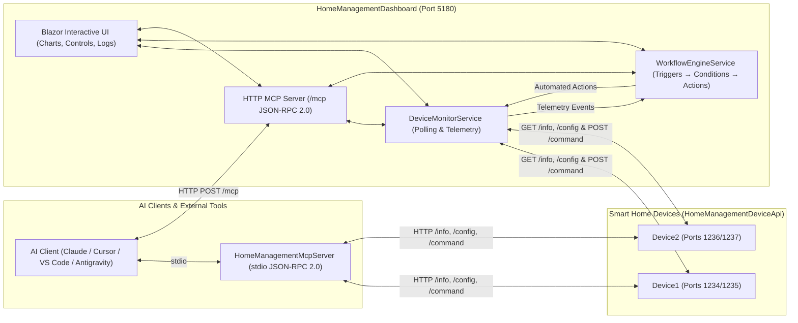

# HomeManagement — Smart Home Device API, Monitoring Dashboard, Workflow Engine & MCP Server

[](https://dotnet.microsoft.com/)
[](https://learn.microsoft.com/aspnet/core/blazor/)
[-0ea5e9)](https://modelcontextprotocol.io/)
[](LICENSE)

A complete **Smart Home Device Management & Automation Platform** built with **.NET 11.0** for the **DataArt IT Camp**.  
The solution combines a lightweight IoT device emulator API, a real-time **Blazor Monitoring Dashboard**, a rule-based **Workflow Automation Engine** (`Trigger → Condition → Action`), and a **Model Context Protocol (MCP) Server** (`stdio` & `HTTP JSON-RPC 2.0`) enabling AI agents to discover and control smart home devices.

---

## Architecture Overview



---

## Solution Structure (`HomeManagement.slnx`)

| Project | Type | Description |
| :--- | :--- | :--- |
| **`HomeManagementDeviceApi`** | ASP.NET Core Minimal API | Simulates smart home IoT devices (`Device1`, `Device2`, etc.), exposing live hardware telemetry (`/info`), supported capabilities (`/config`), and remote command execution (`/command`, `/restart`, `/shutdown`). |
| **`HomeManagementDashboard`** | Blazor Web App (Interactive Server) | Real-time monitoring dashboard displaying **online/offline device counts**, live SVG temperature charts, device status cards, a visual **Workflow Engine**, and an integrated **AI Assistant & HTTP MCP Server**. |
| **`HomeManagementMcpServer`** | .NET Console App (`stdio` MCP) | Standalone **Model Context Protocol (MCP)** server over `stdio` (`JSON-RPC 2.0`, protocol `2024-11-05`) allowing external AI clients to auto-discover devices on the local network and interact with them. |

---

## Key Features

### 1. Real-Time Multi-Sensor Device Monitoring Dashboard
- **Multi-Sensor Telemetry**: Each smart home device reports 5 live hardware/environmental metrics via `GET /info`:
  - **Temperature (`Temperature`, `°C`)** — thermal sensor reading;
  - **Relative Humidity (`Humidity`, `%`)** — ambient humidity level;
  - **Power Consumption (`PowerWatts`, `W`)** — active electrical load;
  - **Air Quality (`Co2Ppm`, `ppm`)** — indoor CO₂ concentration;
  - **System Uptime (`UptimeSeconds`, `s`)** — continuous operation time.
- **Live Fleet KPIs**: Displays the **number of online devices**, offline device alerts, network availability percentage, average climate readings (`°C` & `%`), total power draw (`W`), and average CO₂ (`ppm`).
- **Interactive Telemetry Visualization**: Multi-series real-time **SVG Sensor Trend Chart** with instant switching between **Temperature (`°C`)**, **Humidity (`%`)**, **Power (`W`)**, and **CO₂ (`ppm`)**, alongside comparative device uptime bars.
- **Interactive Device Control Cards**: Shows each device's online status, endpoint URL, local IP address, progress bars for all 4 environmental sensors, formatted uptime, and one-click buttons for all actions advertised by `/config` (`INFO`, `Start Notepad`, `Start Calculator`, `Get Motion`, `Start Paint`, `RESTART`, `SHUTDOWN`) with inline command output.
- **Auto-Discovery & Custom Endpoints**: Scan standard local ports (`1234–1239`, `5000–5001`) with one click or register custom device URLs dynamically.

### 2. Smart Home Workflow Engine (`Trigger → Condition → Action`)
- **Event Triggers (`WHEN`)**:
  - `TelemetryUpdate` — evaluated on every device telemetry poll;
  - `DeviceBecameOnline` — triggered when a device connects to the network;
  - `DeviceBecameOffline` — triggered when a device goes offline;
  - `ManualOnly` — triggered on-demand by the user or an AI agent.
- **Configurable Conditions (`IF`)**:
  - Evaluates `TemperatureCelsius`, `HumidityPercent`, `PowerWatts`, `Co2Ppm`, `UptimeSeconds`, `ResponseTimeMs`, `IsOnline`, or `OnlineDevicesCount` using comparison operators (`>`, `>=`, `<`, `<=`, `==`, `!=`).
- **Automated Actions (`THEN`)**:
  - Executes any remote device command (`POST /command`, `GET /info`, `/restart`, `/shutdown`) or posts a system alert to the dashboard activity log.
  - Built-in cooldown protection (`CooldownSeconds`), manual test execution, and a full execution audit trail.

### 3. AI Integration — Model Context Protocol (MCP) Server
Provides both **stdio** (`HomeManagementMcpServer`) and **HTTP JSON-RPC 2.0** (`POST http://localhost:5180/mcp`) transports:
- `discover_devices` — Scans local ports to discover active smart home devices and their capabilities.
- `list_devices` — Lists all monitored devices with online status, temperature, uptime, and available commands.
- `get_device_details` / `get_device_info` — Retrieves real-time `/info` and `/config` for a specific device.
- `execute_device_action` — Executes an action or command on a target device and returns `stdout`/`stderr`.
- `list_workflows` — Lists all configured smart home automation rules.
- `create_workflow` — Creates a new `Trigger → Condition → Action` automation rule.
- `trigger_workflow` — Manually executes an automation workflow by ID or name.

---

## Prerequisites

- **[.NET 11.0 SDK](https://dotnet.microsoft.com/download/dotnet/11.0)** (`11.0.100` or newer)

Verify your SDK installation:
```bash
dotnet --list-sdks
```

---

## Getting Started (Build & Run)

### 1. Build the Entire Solution
From the repository root directory:
```bash
dotnet build HomeManagement.slnx
```

### 2. Start the Emulated Smart Home Devices (`Device1` & `Device2`)
Open two terminal windows in the `HomeManagementDeviceApi` folder:

**Terminal 1 (`Device1` — listens on `https://localhost:1234` and `http://localhost:1235`):**
```bash
cd HomeManagementDeviceApi
dotnet run --no-build --launch-profile Device1
```

**Terminal 2 (`Device2` — listens on `https://localhost:1236` and `http://localhost:1237`):**
```bash
cd HomeManagementDeviceApi
dotnet run --no-build --launch-profile Device2
```

Verify the device endpoints in your browser:
- `http://localhost:1235/info` and `http://localhost:1235/config`
- `http://localhost:1237/info` and `http://localhost:1237/config`

### 3. Start the Monitoring Dashboard, Workflow Engine & HTTP MCP Server
Open a third terminal window:
```bash
cd HomeManagementDashboard
dotnet run --no-build
```

Open **`http://localhost:5180`** in your browser:
- **Tab 1 — `📡 Моніторинг та телеметрія`**: Live online device count, temperature charts, device status cards, and remote action buttons.
- **Tab 2 — `⚡ Workflow Engine`**: Create, toggle, and test smart home automation scenarios.
- **Tab 3 — `🤖 AI Integration & MCP Server`**: Built-in AI natural-language assistant and interactive MCP JSON-RPC tool inspector.

---

## Connecting External AI Clients via MCP

Add the following configuration to your AI client (`mcp.json`, `claude_desktop_config.json`, Cursor, VS Code Copilot, or Antigravity IDE):

```json
{
  "mcpServers": {
    "smart-home-stdio": {
      "command": "dotnet",
      "args": [
        "run",
        "--no-build",
        "--project",
        "HomeManagementMcpServer/HomeManagementMcpServer.csproj"
      ]
    },
    "smart-home-http": {
      "url": "http://localhost:5180/mcp"
    }
  }
}
```

Test the standalone `stdio` MCP server directly from the terminal:
```powershell
'{"jsonrpc":"2.0","id":1,"method":"tools/list"}' | dotnet run --no-build --project HomeManagementMcpServer
```

---

## REST & MCP Endpoints Reference

### Device API (`HomeManagementDeviceApi`)
| Method | Endpoint | Description |
| :--- | :--- | :--- |
| `GET` | `/info` | Returns `DeviceInfo` (`Name`, `Address`, `Metrics`: `UptimeSeconds`, `Temperature`). |
| `GET` | `/config` | Returns `DeviceConfig` (`Name`, `Address`, `Actions`). |
| `POST` | `/command` | Executes a configured process (`FileName`, `Arguments`) and returns its output. |
| `POST` | `/restart` | Triggers device reboot command. |
| `POST` | `/shutdown` | Triggers device shutdown command. |

### Dashboard & MCP Hub (`HomeManagementDashboard`)
| Method | Endpoint | Description |
| :--- | :--- | :--- |
| `GET` | `/` | Interactive Blazor Monitoring Dashboard, Workflow Builder & AI Assistant UI. |
| `GET` | `/api/dashboard/summary` | JSON summary of total/online/offline devices, telemetry, and active workflows. |
| `GET` | `/api/workflows` | JSON list of automation scenarios and execution history. |
| `GET` | `/mcp/tools` | Lists all available MCP tools and their input JSON schemas. |
| `POST` | `/mcp` | Model Context Protocol (MCP) JSON-RPC 2.0 endpoint (`initialize`, `tools/list`, `tools/call`, `resources/list`). |

---

## Security & License

- Please review [SECURITY.md](SECURITY.md) for security considerations regarding remote command execution and local network deployment.
- Licensed under the [MIT License](LICENSE).
